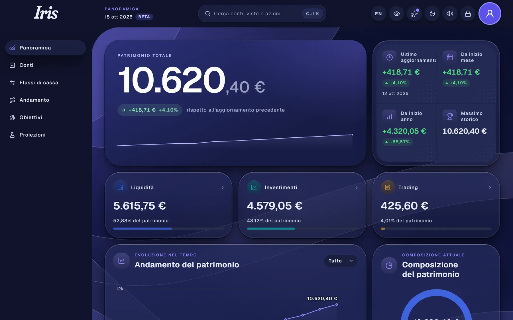
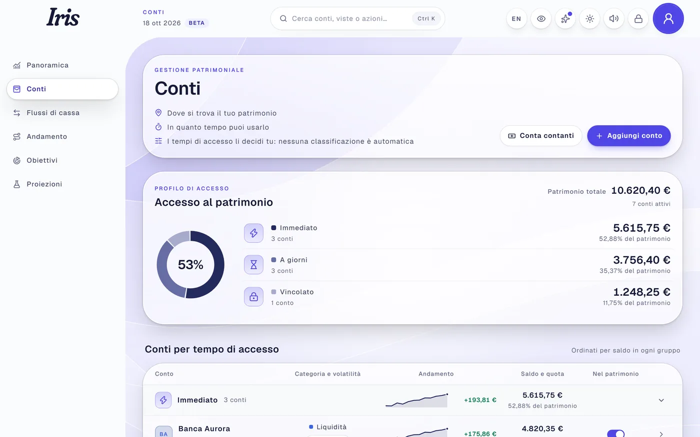
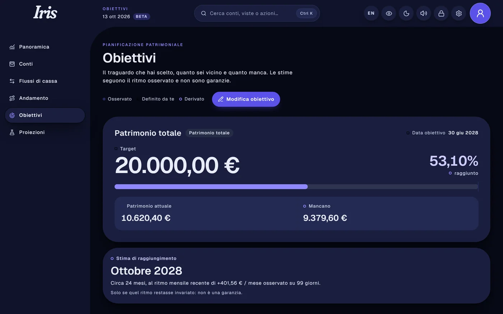
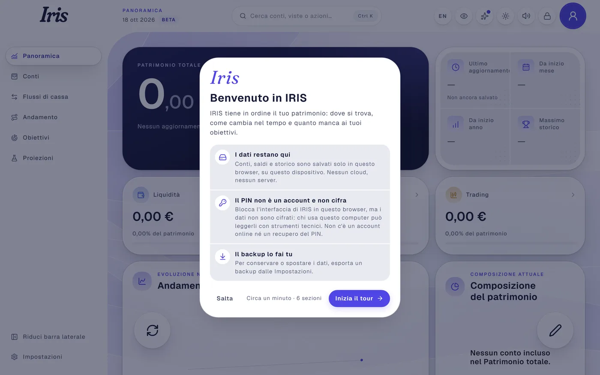

# IRIS

**Your wealth. One clear view.**

IRIS ti mostra dove si trova il tuo patrimonio, come cambia nel tempo e quanto manca ai tuoi obiettivi. 
Funziona nel tuo browser, senza account e senza cloud.

Beta · Windows 10 e 11 · Italiano e inglese

 

  

Le immagini mostrano dati inventati.

## Cosa puoi fare

- **Vedere tutto il patrimonio.** Conti, investimenti e contanti in un unico totale, con le variazioni nel tempo.
- **Organizzare i conti.** Per tipo e per tempo di accesso: subito, in pochi giorni, vincolato.
- **Seguire un obiettivo.** Quanto hai raggiunto, quanto manca e una stima di quando ci arriverai.
- **Simulare scenari.** Confronta due possibili andamenti futuri senza toccare i tuoi dati.

  
  

## Come iniziare

1. **Installa [Node.js LTS](https://nodejs.org)**, se non lo hai già.
2. **Scarica IRIS:** in alto in questa pagina premi **Code › Download ZIP**, poi estrai la cartella.
3. **Fai doppio clic su `Avvia IRIS.bat`.**

IRIS si apre da sola nel browser. Al primo avvio scegli un PIN e segui il tutorial: circa un minuto per conoscere le sezioni principali.

La prima volta servono alcuni minuti e una connessione a internet; poi IRIS parte in pochi secondi. Per spegnerla, chiudi la finestra nera.

  

## Privacy e backup

> [!IMPORTANT]
> - **I dati restano nel browser di questo computer.** IRIS non li invia da nessuna parte.
> - **Il PIN protegge l'interfaccia, ma non cifra i dati.**
> - **Esporta regolarmente un backup** da *Impostazioni › Dati*: è l'unica copia che sopravvive se il browser cancella i dati.
> - **È una beta:** per provarla usa solo dati inventati.

## Altre informazioni

Requisiti, aggiornamenti, problemi frequenti, disinstallazione e istruzioni per sviluppatori sono nella **[guida completa](docs/GUIDA.md)**.

---

<b>In English</b>

 

IRIS is a personal wealth dashboard that runs in your browser and keeps your data on your computer: no account, no cloud.

1. Install [Node.js LTS](https://nodejs.org).
2. Download this repository (**Code › Download ZIP**) and extract it.
3. Double-click **`Avvia IRIS.bat`**: IRIS opens in your browser, where you set a PIN and can follow the tour.

The PIN locks the interface but does not encrypt the data. Export a backup regularly from *Settings › Data*. IRIS is in beta: use invented data. The interface is available in English from the top bar; the [full guide](docs/GUIDA.md) is in Italian, with an English summary.

